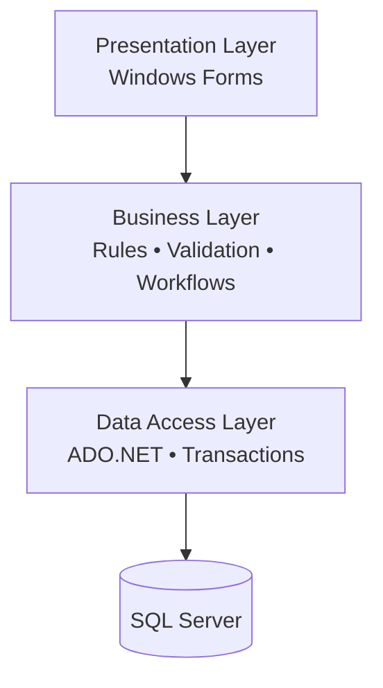

# 🚗 DVLD Management System
**Windows Desktop Application - .NET | ADO.NET | SQL Server**

---

## 📌 Overview
The DVLD Management System is a full-scale Windows Desktop Application that simulates the real-world operations of a Driving License & Vehicle Department.

It was built as the capstone project of a software development course, applying proper layered architecture and clean software engineering principles end to end.

The system handles the complete driving-license lifecycle: applications, tests, license issuing, renewal, replacement, international licenses, and detaining, with strict business rules and full traceability.

---

## ❓ Problem Statement
Many desktop applications suffer from:
- Mixing UI logic with business logic and database access
- Weak validation and poor error handling
- Difficult maintenance and scalability
- Lack of workflow control and traceability
- Absence of logging and monitoring

This project was built to solve these problems by applying proper layered architecture from the ground up.

---

## 🏗️ System Architecture

### 🔹 3-Layered Architecture Diagram



### 🔹 Layer Responsibilities

**Presentation Layer**
- Windows Forms user interface
- Handles user interaction and input only
- No business logic, no direct database access

**Business Layer**
- Core business rules and centralized validation
- License lifecycle management
- Application and workflow processing

**Data Access Layer**
- SQL Server access using ADO.NET
- Parameterized queries (SQL injection prevention)
- Transaction-based operations (Commit / Rollback)

---

## 📂 Repository Contents

```
DVLD-System/
│
├── DVLD_Buisness1/        # Business layer (rules, validation, workflows)
│   ├── clsPerson.cs
│   ├── clsApplication.cs
│   ├── clsLocalDrivingLicenseApplication.cs
│   ├── clsLicense.cs
│   └── ...
│
├── DVLD_DataAccess1/      # Data access layer (ADO.NET, parameterized queries)
│   ├── clsPersonData.cs
│   ├── clsApplicationData.cs
│   ├── clsDataAccessString.cs   # connection string lives here
│   └── ...
│
├── DVLD.bak               # SQL Server database backup (restore to run)
└── Images/                # sample person photos used by the app
```

> **Note:** The Windows Forms presentation layer is being prepared for upload and is not in this repository yet. The two class libraries here show the business rules and data access design in full.

---

## 👥 Core Features
- People & Drivers Management
- Local & International License Management
- First-time License Issuing
- License Renewal & Replacement (lost/damaged)
- Detained License Handling (Detain / Release)
- Driving Tests Scheduling and Execution (vision, theory, practical)
- Application workflow tracking
- User management with permissions
- Centralized Validation & Logging

---

## 🧼 Code Quality & Design
- Clean Code principles
- Separation of Concerns
- Single Responsibility Principle (SRP)
- Reusable and maintainable components

---

## 🔐 Security & Data Integrity
- SQL Injection prevention using parameterized queries
- SQL Server transactions (Commit / Rollback)
- Centralized validation across layers

---

## 🧾 Logging & Monitoring
- Windows Event Logger integration
- Error, warning, and activity logging
- Improved debugging, auditing, and reliability

---

## ⚙️ Technology Stack
- C# (.NET Framework, Windows Forms)
- ADO.NET
- Microsoft SQL Server + SSMS
- Visual Studio 2022
- Git & GitHub

---

## ▶️ Getting Started

### 1️⃣ Requirements
- Windows
- Visual Studio 2022
- .NET Framework 4.7.2+
- Microsoft SQL Server + SSMS

### 2️⃣ Database Setup
1. Open SSMS and connect to your SQL Server instance.
2. Right-click **Databases** → **Restore Database** → **Device** → select the included `DVLD.bak`.
3. Verify the tables and relationships were created.

### 3️⃣ Configuration
1. Open `DVLD_DataAccess1/clsDataAccessString.cs`.
2. Update the connection string to point to your SQL Server instance. Prefer Windows Authentication (`Integrated Security=True`) or a dedicated SQL login - avoid using `sa` outside a course environment.

### 4️⃣ Run
- Open the projects in Visual Studio, build, and run.

---

## 🎯 Project Goal
To demonstrate how to build a professional, secure, and maintainable Windows desktop system using correct architecture and real-world workflows.
